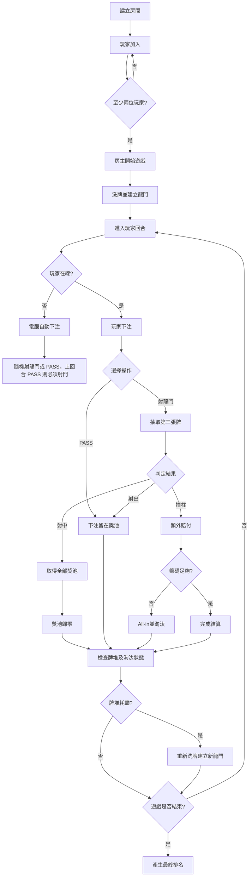

# 射龍門多人網頁遊戲 — Software Requirements Specification

**文件版本：** v2.19
**文件狀態：** 開發規格基準
**產品類型：** RWD 多人即時網頁遊戲
**支援裝置：** 手機、平板、桌面瀏覽器
**遊戲模式：** 私人房間、多人對戰、虛擬籌碼
**最後修訂：** 2026-11-07

## 修訂紀錄
| 版本 | 日期 | 摘要 |
|---|---|---|
| v1.0 | 2026-11-06 | 初版規格。 |
| v1.1 | 2026-11-06 | 釐清矛盾與缺口：離線代打改為真的打牌（隨機射門或 PASS）；新增每回合決策時限；不可連續 PASS；淘汰在結算後判斷；剔除與逾時一律由電腦代打；牌堆耗盡先結算；統計機率分母；cookie 重連；預計部署 AWS。 |
| v1.2 | 2026-11-06 | 當局結束改為射中、撞柱、牌堆耗盡三種（收牌、洗牌、重設龍門）；決策時限改 30 秒；房間密碼改選填；房號改 6 碼數字；新增玩家手動「代打」開關；介面調整（下注區在牌桌下、顯示玩家人數、玩家排名取代遊戲紀錄、籌碼 − ＋ 步進器、翻牌動畫）。 |
| v1.3 | 2026-11-06 | 翻牌歷史改為接龍式牌面總覽，每局重置、不提前顯示未翻開的牌。 |
| v2.0 | 2026-11-06 | **規則變更**：導入莊家制度，取代原本「獎池延續到下一局」；全員淘汰後電腦自動加速；離開按鈕改為回首頁並由電腦代打；大廳按鈕列上移；電腦玩家改用隨機中二名稱；玩家排名平滑動畫與莊家標記；獎池顯示不得回跳。 |
| v2.1 | 2026-11-06 | **規則變更**：撞柱結束時獎池（含額外賠付）保留到下一局，莊家連莊並先開局；莊家被淘汰則順延。 |
| v2.2 | 2026-11-07 | **規則修正**：首局由莊家（房主）先行動（原本誤由座位第一位先手）；手機頂欄收合為「莊家＋玩家人數」與「獎池」，其餘資訊移入 ☰ 側邊選單；離開按鈕放大。 |
| v2.3 | 2026-11-07 | **規則變更**：莊家撞柱時額外賠付加倍（2 倍）。**修正**：手機窄螢幕不得橫向捲動（翻牌動畫飛出畫面、籌碼步進器在 320px 寬度超出）。 |
| v2.4 | 2026-11-07 | **規則變更**：莊家本人撞柱後不得連莊，依座位順序換下一位當莊家並先開局（一般玩家撞柱仍連莊）；明訂莊家輪替一律依座位順序、不隨機。 |
| v2.5 | 2026-11-07 | **規則變更**：牌組改為兩副牌（104 張）；翻牌歷史中重複出現的牌在該格右下角顯示「2」。 |
| v2.6 | 2026-11-07 | **規則變更**：龍門牌除了點數不得相同，也不得連續（差 1），連續時丟棄重抽；A 與 K 不算連續。取代先前「連號門柱照常允許」的做法。 |
| v2.7 | 2026-11-07 | **規則變更**：每局結束莊家一律依座位順序往下輪（取消連莊，並廢除不可能發生的「牌堆耗盡莊家贏走獎池」，改為獎池保留）；莊家撞柱賠付改為減半（原為加倍）；新增窄門加賠：窄門被非莊家射中時莊家另付獎池的一半。 |
| v2.8 | 2026-11-07 | **規則變更**：牌組改回單副 52 張（兩副牌 104 張節奏過慢）；牌副數改由單一設定值控制，翻牌歷史的「2」角標僅在多副牌設定時出現。 |
| v2.9 | 2026-11-07 | **規則變更**：新增籌碼封鎖——牌堆已用 10%／15%／20% 時依序封鎖 50／100／500 籌碼，最小下注隨之提高，All-in 永遠允許；門檻依模擬數據訂定。**修正**：iPhone 連點不再觸發網頁放大。 |
| v2.10 | 2026-11-07 | 籌碼封鎖門檻各放寬 5 個百分點（10%／15%／20% 改為 15%／20%／25%）；新增全押全螢幕特效，所有玩家同步看到。 |
| v2.11 | 2026-11-07 | **規則變更**：移除房間密碼，僅以 6 碼房號加入；房主可在等候房選 1 副（預設）或 2 副牌，2 副牌的籌碼封鎖門檻減半（7.5%／10%／12.5%，經模擬驗證）；莊家新增好處：本人射中窄門時向其他玩家共同收取所贏獎池的一半；結果表格新增 PASS 次數與可為負數的損益；全電腦對局不播效果並批次處理以盡快結束。 |
| v2.12 | 2026-11-07 | 房主可在等候房把玩家設為觀察者；**規則變更**：門柱連號（如 8、9）重新允許（沒有球門，只能射出或撞柱，可用來加大獎池逼人撞柱出局），只剩點數相同才重抽；等候房每位玩家顯示勝場數，結算表改由房主帶大家回到等候房；新增等候房純文字聊天室。 |
| v2.13 | 2026-11-07 | **規則變更**：結算畫面改為每位玩家各自「再玩一局」／「離開遊戲」（取代房主統一帶大家回去）；第一位回等候房的玩家起算 5 分鐘，房主未回來就依回來的順序轉給第一個回來的玩家；還在看結算的人於開局時成為觀察者；窄螢幕牌組選項換行；窄螢幕側邊選單加入「離開遊戲」。 |
| v2.14 | 2026-11-07 | 畫面調整：「牌堆已用 N%」與「我的籌碼」放在同一列。 |
| v2.15 | 2026-11-07 | 結算表拿掉「損益」欄（沒有意義），保留最終籌碼與 PASS 次數。 |
| v2.16 | 2026-11-07 | 等候房排版：螢幕夠寬（≥ 900px）時玩家清單與聊天室左右併排；窄螢幕維持先玩家、後聊天室。 |
| v2.17 | 2026-11-07 | 修正畫面跳動：「輪到誰」區改為固定三行，結果橫幅隱形但保留位置，連號門柱提示改為門柱之間的小標籤；實測各狀態切換時下注區的位置變動由 76 像素降為 0。 |
| v2.18 | 2026-11-07 | 新增窄門提示、連號門柱提示改位置：兩者都顯示在牌桌右上角（窄門金色並說明唯一能射中的點數，連號紅色）。 |
| v2.19 | 2026-11-09 | 新增房間回收機制：伺服器每分鐘清理一次，已關閉（CLOSED）的房間立即移除；沒有任何真人連線且 30 分鐘無活動的房間也移除（含 cookie 綁定與計時器）。有真人連線的房間無論多安靜都不會被回收。 |

---

# 1. 專案目標
開發一款可透過瀏覽器遊玩的多人射龍門遊戲。

玩家可以建立私人房間，把房間號碼告訴夥伴，邀請其他玩家加入。所有玩家在同一房間內使用同一副撲克牌進行遊戲，依序下注、射龍門或 PASS，直到所有玩家依籌碼歸零的順序完成排名。

系統必須確保：
1. 所有玩家看到相同的遊戲狀態。
2. 遊戲結果由伺服器統一判定，不允許客戶端自行決定結果。
3. 籌碼、獎池、牌堆及回合狀態均由伺服器管理。
4. 玩家短暫離線不會中斷整場遊戲。
5. 遊戲支援手機、平板及桌面裝置。
6. 遊戲結束後能正確產生所有玩家的最終排名。

# 2. 名詞定義
| 名詞 | 定義 |
|---|---|
| 房間 Room | 玩家進行遊戲的私人空間 |
| 房主 Host | 建立房間的玩家，擁有房間管理權限 |
| UID | 系統產生的唯一玩家識別碼 |
| 籌碼 Chips | 玩家持有的虛擬遊戲資產 |
| 獎池 Pot | 所有玩家本場下注及額外賠付所累積的籌碼 |
| 龍門 Gate | 每局開始時公開的兩張公共門柱牌 |
| 射門 Shoot | 玩家翻開第三張牌，進行射龍門判定 |
| PASS | 玩家下注後選擇不翻開第三張牌 |
| 撞柱 Collision | 第三張牌與任一張門柱牌點數相同 |
| All-in | 玩家投入目前所有剩餘籌碼 |
| 當局 Round | 使用目前龍門牌及牌堆進行的遊戲階段 |
| 整場遊戲 Match | 從遊戲開始至所有玩家排名完成的完整對戰 |

# 3. 房間與玩家管理
## 3.1 建立房間
玩家可以建立私人房間，建立時只需要輸入：
- 玩家暱稱。

本遊戲**沒有房間密碼**：房主自行把房號告訴夥伴即可，知道房號的人就能在開局前加入。

系統自動產生：
- 唯一房間識別碼 Room ID（6 碼數字）。
- 唯一玩家識別碼 UID。

房間建立者自動成為房主。

## 3.2 加入房間
玩家輸入 6 碼房間號碼即可加入（不需要密碼）。

加入成功後：
- 玩家取得唯一 UID。
- 玩家暱稱顯示於房間。
- 玩家獲得初始籌碼 100,000。
- 玩家加入房間玩家名單。

暱稱允許重複，UID 不允許重複。

## 3.3 房間人數
- 最少開始人數：2 人。
- 最多人數：12 人。
- 未滿 2 人時，房主不能開始遊戲。
- 遊戲開始後，不允許新玩家加入成為參賽者。
- 已離開的玩家可以重新加入原房間。

## 3.4 房主權限
房主具有以下權限：
1. 開始遊戲。
2. 剔除房間玩家。
3. 管理房間狀態。
4. 建立電腦玩家以填充玩家人數。

房主剔除玩家時：
- 遊戲開始前：該玩家被移出房間。
- 遊戲進行中：該玩家仍保留在遊戲內，其回合一律由電腦代打（同第 8 章），直到淘汰並取得排名。

若房主離開房間：
- 系統從其他符合資格的房間玩家中隨機選出新房主。
- 新房主立即取得房主管理權限。
- 不因房主離開而中斷遊戲。

若沒有其他符合資格的玩家，房間結束。

## 3.4.1 牌組選擇
房主在等候房可以選擇本場使用的牌組（單選）：
- **1 副牌（52 張）**，預設。
- **2 副牌（104 張）**：兩副牌混合洗牌，同花色同點數的牌會出現兩次。
- 只有房主能更改；其他玩家只能看到目前選擇。遊戲開始後不可更改。
- 牌副數影響籌碼封鎖的百分比門檻（見 4.3.1），規則其餘部分相同。

## 3.4.2 觀察者模式
房主在等候房可以用勾選框把已加入的玩家設為**觀察者**：
- 觀察者看得到整場遊戲，但不參賽：沒有座位、沒有籌碼、不下注、不射門、不出現在玩家排名與結算表。
- 觀察者不算參賽人數：至少要 2 位參賽玩家（觀察者不算）才能開始。
- 房主本人必須參賽，電腦玩家不能設為觀察者。若房主離開、由觀察者接任房主，該玩家自動轉為參賽。
- 只能在等候房設定；遊戲開始後不能更改。觀察者隨時可以離開，離開不會影響牌局。
- 房間總人數上限仍為 12（參賽者加觀察者）。
- 若剩下的參賽玩家全是電腦，仍會加速結束（觀察者不算活人玩家，見 8.7）。

## 3.4.3 結算後：再玩一局、離開遊戲、房主轉移與勝場數
**結算畫面**：每位玩家（房主或非房主）各自有兩個按鈕，**再玩一局**與**離開遊戲**，可以自己離開結算畫面，不必等任何人。
- 按「再玩一局」的玩家就回到等候房；還沒按的人繼續看結算表。第一位按下的人讓房間變成等候房，之後按的人陸續加入。
- 回到等候房時，玩家座位、電腦玩家、觀察者設定、勝場數都保留；比賽中途離開或被剔除的人會被移出房間（被剔除者仍列入黑名單）。
- 等候房的玩家列表上，還在看結算的人標示「看結算中」，參賽人數只算已經回來的人。
- 房主開始下一場時，**還在看結算、沒來得及按「再玩一局」的人會自動成為觀察者**，繼續在畫面上看新的一場。
- 所有人都回來（或離開）後，上一場的結算表就不再保留。

**房主逾時轉移**（5 分鐘）：
- 以**第一位回到等候房的玩家**開始計時 5 分鐘；若第一位就是房主，不計時。
- 5 分鐘內房主沒回來，房主身分**自動轉給第一個回來的玩家**。房主稍後才回來，只是一般玩家。
- 若這位新房主又離開，房主給**第二順位**（依回來的先後），再離開就給第三順位，以此類推；這個順序不是隨機的。
- 房主在 5 分鐘內回來，計時取消、仍是房主。房主在還沒有人回來前就離開，維持原本的隨機轉移。
- 等候房畫面對已回來的人顯示倒數：「房主還沒回來。m:ss 後，房主會自動轉給第一個回來的玩家（名字）」。
- 伺服器重啟後，計時與順序仍然有效。
- **勝場數**：等候房每位玩家（含房主、電腦）的那一列顯示「勝 N 場」。整場排名第 1 的玩家勝場 +1，累計於該房間，用來看誰比較會玩。

## 3.4.4 等候房聊天室
- 只在等候房開放（含結算後回到等候房）；遊戲進行中不顯示。
- **只允許文字**：換行與控制字元一律轉為空白，訊息以純文字顯示，不解析任何 HTML 或連結；每則最多 200 字。
- 每位玩家每 0.7 秒最多發一則；空白訊息被拒絕。觀察者也可以發言。
- 房間保留最近 100 則，畫面顯示最近 50 則。
- 打字到一半時，伺服器更新（有人加入、勾選觀察）不得清掉輸入內容或讓輸入框失去焦點。

## 3.5 玩家離線與重新加入
玩家可能因網路中斷、關閉瀏覽器或切換裝置而離線。

系統必須：
- 偵測玩家連線狀態。
- 保留玩家 UID、籌碼及遊戲紀錄。
- 不因短暫離線而直接淘汰玩家。
- 輪到離線玩家時，自動執行電腦代打。
- 玩家重新加入後，同步目前遊戲狀態。

**重新加入限制：**

玩家中途離開後重新加入（以 cookie 辨識身分，見 15.1），不可中斷已經執行的回合，也不可重新操作已經完成的回合；下一次輪到自己時恢復正常操作。
只有已淘汰的玩家才是觀戰狀態。

**操作時限：** 每位玩家每回合有 30 秒決策時間（含下注與射門／PASS）。逾時視為該回合由電腦代打（同第 8 章；若已下注則沿用該注金額，再隨機決策）。

# 4. 籌碼系統
## 4.1 初始籌碼
每位玩家開始遊戲時取得：
**100,000 籌碼**

遊戲開始後，玩家不得額外購買或補充籌碼。

## 4.2 籌碼面額
系統提供四種籌碼：
| 籌碼面額 | 顯示 |
|---:|---|
| 50 | 50 |
| 100 | 100 |
| 500 | 500 |
| 1,000 | 1,000 |

所有籌碼金額均為 50 的倍數。

## 4.3 下注規則
- 最低下注金額：50。
- 下注金額沒有固定上限。
- 不得超過玩家目前持有的籌碼。
- 玩家可以自由混合不同面額的籌碼。
- 玩家確認下注後，系統立即扣除對應籌碼。
- 扣除的籌碼直接加入當局獎池。

例如：
玩家可以選擇：
- 1,000 × 2
- 500 × 3
- 100 × 2
- 50 × 1

總下注金額為 3,750。玩家可以在確認下注前調整籌碼組合。

### 4.3.1 籌碼封鎖
隨著牌堆用掉，系統由小到大逐步封鎖籌碼，讓獎池快速變大，避免有人一直下小注拖慢遊戲：
| 牌堆已用 | 封鎖的籌碼 | 目前最小可用籌碼 | 52 張牌時對應 |
|---|---|---|---|
| 未達 15% | 無 | 50 | 剩餘 45 張以上 |
| ≥ 15% | 50 | 100 | 剩餘 44 張以下 |
| ≥ 20% | 50、100 | 500 | 剩餘 41 張以下 |
| ≥ 25% | 50、100、500 | 1,000 | 剩餘 39 張以下 |
- 「牌堆已用」= 已不在牌堆中的牌占整副牌的百分比（含龍門牌、重抽被丟棄的牌與已翻出的牌），於**下注當下**判斷。
- 四種籌碼最多封鎖三種，1,000 籌碼永不封鎖。
- 被封鎖的籌碼不能使用，因此下注金額必須是「目前最小可用籌碼」的倍數，最低下注也隨之提高（例如最小可用籌碼為 500 時，最低下注 500，且 700 不合法）。
- **All-in 永遠允許**：籌碼不足最小可用籌碼，或持有金額無法由開放的籌碼湊成時，仍可全部投入，避免玩家無法下注。
- 新的一局重新洗牌後封鎖解除，從頭計算。
- 畫面：「🔒 牌堆已用 N%」顯示在**操作區「我的籌碼」同一列**（不另佔一列）；被封鎖的是哪幾種籌碼，由籌碼上的 🔒 與灰階標示，最小下注顯示在下方的「最低 N」。窄螢幕放不下時，右側的「代打」開關換到下一列，「我的籌碼」與「牌堆已用」不拆開。
- **2 副牌時門檻減半**：同樣一局仍只翻約 2.5 張牌，但每張牌只占牌堆的一半，所以百分比同步縮小，才會在「用掉相同張數」時封鎖：
| 牌副數 | 封鎖 50 | 封鎖 100 | 封鎖 500 | 對應已用張數 |
|---|---|---|---|---|
| 1 副（52 張） | ≥ 15% | ≥ 20% | ≥ 25% | 8、11、13 張 |
| 2 副（104 張） | ≥ 7.5% | ≥ 10% | ≥ 12.5% | 8、11、13 張 |
- 模擬驗證（各 960 萬次下注）：1 副牌 15%／20%／25% 影響 12.9%／4.6%／2.3% 的下注；2 副牌 7.5%／10%／12.5% 影響 12.9%／4.8%／2.5%，兩者幾乎一致。若 2 副牌沿用 15%／20%／25%，只會影響 1.0%／0.2%／0%，封鎖形同不存在。
- 門檻訂這麼低的原因：每局遇到射中或撞柱就結束、重新洗牌，平均一局只翻約 2.6 張牌。模擬 390 萬局，下注當下牌堆已用 ≥ 25% 的只占 2.3%、≥ 30% 占 0.8%、≥ 40% 只占 0.1%；若用 25%／50%／75% 幾乎不會觸發。15%／20%／25% 約影響 13%／5%／2% 的下注（最初的 10%／15%／20% 約影響 26%／13%／5%，後各放寬 5 個百分點）。

## 4.4 All-in
玩家可以將目前所有剩餘籌碼投入下注。
All-in 不需要額外的特殊遊戲流程，實際上就是下注金額等於目前全部籌碼。

## 4.5 籌碼淘汰
玩家籌碼歸零時：
- 立即判定淘汰。
- 不再參與後續下注。
- 切換為觀戰狀態。
- 記錄淘汰順序及最終名次。

玩家不得補充籌碼重新參賽。

# 5. 撲克牌系統
## 5.1 牌組
使用一副標準撲克牌：
- 共 52 張。
- 不包含鬼牌。
- 四種花色：♠、♥、♦、♣。
- 每種花色 13 張；每個點數共 4 張。
- 預設 1 副牌；房主可在等候房改選 2 副牌（104 張，同一張牌可出現兩次），見 3.4.1。

## 5.2 點數規則
| 牌面 | 點數 |
|---|---:|
| A | 1 |
| 2～10 | 2～10 |
| J | 11 |
| Q | 12 |
| K | 13 |

花色不影響牌點大小。

## 5.3 洗牌
- 每當牌堆進入新的一局時，系統自動洗牌。
- 所有玩家共用同一副牌。
- 抽過的牌不放回牌堆。
- 牌堆順序由伺服器產生並保存。
- 客戶端不得自行產生或修改牌序。

## 5.4 龍門牌
每局開始時，系統自動翻開兩張公共龍門牌。

龍門牌必須符合：
**兩張門柱牌的點數不得相同。**
- **連號是允許的**：例如 8 與 9，只有兩根門柱、中間沒有球門，這組龍門**不可能射中**，翻出的牌只會是射出或撞柱。
- 這是刻意的策略空間：玩家可以趁連號門柱故意加大獎池，讓其他玩家撞柱時觸發賠付機制而賠光籌碼、出局（也可以是淘汰別人的手段）。
- 畫面在牌桌右上角顯示紅色「⚠ 連號門柱：不可能射中」。
- A 與 K（1 與 13）點數差 12，不算連號。

若抽出的兩張牌點數相同：
1. 該次抽牌不成立，這兩張牌丟棄（不放回）。
2. 系統繼續從剩餘牌堆抽牌。
3. 直到取得兩張點數不同的牌。
4. 成功後公開為本局龍門牌。

抽出的牌不放回牌堆。
兩張龍門牌確定後，所有玩家共用這組龍門牌，直到當局結束。

## 5.5 第三張牌判定
玩家選擇射龍門後，系統從牌堆抽出第三張牌。
設兩張門柱牌點數為 A、B，先取得：

- Low = min(A, B)
- High = max(A, B)

第三張牌點數為 C。

| 條件 | 判定 | 結果 |
|---|---|---|
| Low < C < High | 射中 | 取得全部獎池 |
| C = Low 或 C = High | 撞柱 | 額外賠付 |
| C < Low 或 C > High | 射出 | 下注留在獎池 |

判定一律使用嚴格區間，不包含兩側門柱。

# 6. 遊戲流程
## 6.1 開始遊戲
房主按下開始遊戲後：
1. 檢查房間至少有 2 位玩家。
2. 將房間玩家設定為參賽者。
3. 每位玩家取得 100,000 籌碼。
4. 初始化獎池為 0。
5. 初始化玩家淘汰紀錄。
6. 建立玩家回合順序。
7. 洗牌。
8. 抽取兩張不同點數的公共龍門牌。
9. 進入遊戲狀態。
10. 由莊家（房主）先行動，之後依座位順序輪流。

## 6.2 玩家回合
玩家依照目前玩家順序輪流操作。

每位玩家回合：
1. 系統確認玩家是否仍具參賽資格。
2. 確認玩家是否在線。
3. 顯示目前兩張公共龍門牌。
4. 玩家選擇下注籌碼組合。
5. 玩家確認下注。
6. 系統扣除玩家籌碼，並將下注加入獎池。
7. 玩家選擇：
   - 射龍門 Shoot
   - PASS
8. 系統執行對應流程。
9. 結算籌碼及獎池。
10. 檢查玩家是否淘汰。
11. 進入下一位玩家回合。

## 6.3 射龍門
玩家完成下注後選擇射龍門。

系統：
1. 從剩餘牌堆抽取一張牌。
2. 公開第三張牌。
3. 判斷射中、射出或撞柱。
4. 執行對應的籌碼結算。
5. 公開結果給所有玩家。

射龍門會消耗一張牌。

## 6.4 PASS
PASS 是正常的下注選項。

玩家完成下注後選擇 PASS：
- 不抽取第三張牌。
- 不進行射中、射出或撞柱判定。
- 不消耗牌堆中的牌。
- 已下注的籌碼留在獎池。
- 直接結束當前玩家回合。

PASS 不代表免下注，也不代表退回下注籌碼。

**不可連續 PASS：** 玩家上一回合選擇 PASS，則本回合不能 PASS，必須射龍門。此規則以每位玩家為單位，電腦代打亦適用。

**淘汰判斷時機：** 下注後籌碼為 0（All-in）不會立即淘汰，須待該回合翻牌結算完成後才判斷；撞柱賠付不足而清零者，結算時直接淘汰。

# 7. 獎池與結算規則
## 7.1 獎池定義
獎池就是玩家在當局投入的所有下注籌碼，以及撞柱時額外賠付的籌碼。
不存在另一個獨立的公共彩金池或額外獎金帳戶。
玩家下注後，籌碼直接加入獎池。

## 7.2 射中
玩家第三張牌嚴格落在兩張門柱之間時，判定射中。

結算方式：
1. 取得當下獎池的全部籌碼。
2. 將獎池全部轉入射中玩家的籌碼。
3. 獎池歸零。
4. 結束該玩家回合。

公式：
`玩家新籌碼 = 玩家下注後剩餘籌碼 + 當下獎池`
`獎池 = 0`

### 7.2.1 窄門加賠
**窄門**：兩張門柱點數剛好差 2（中間只隔一個點數），例如 7 與 9，只有 8 能射中。
- 當窄門被**非莊家**玩家射中時，**莊家要另外付給射中者「獎池的一半」**，金額取最接近且能被 50 整除的數（恰好在中間時進位）。
- 「獎池」指射中者本次下注後、即將贏走的完整獎池。
- 例：下注後獎池 600，窄門被非莊家射中：射中者先取走 600，莊家再額外付 300 給射中者。
- 莊家籌碼不足時，莊家付出所有剩餘籌碼並淘汰（同 7.5 的處理）。
- 莊家本人射中窄門、寬門被射中、射出、撞柱、PASS，一律沒有此加賠。
- 加賠是玩家之間的轉移，不增減籌碼總量，也不影響獎池歸零。

### 7.2.2 莊家搜括
當**莊家本人**射中窄門時，除了取走完整獎池，還可以向**其他玩家共同**收取「他所贏得獎池的一半」：
- 總額 = 莊家贏得的獎池 ÷ 2（取最接近且能被 50 整除的數）。
- 每位其他玩家分擔：總額 ÷ 其他玩家人數，再取最接近且能被 50 整除的數（恰好在中間時進位）。「其他玩家」指尚未淘汰、且不是莊家的玩家。
- 例：莊家射中窄門贏得 15,000，一半 7,500；除莊家外有 3 位玩家，每人付 2,500，莊家共多收 7,500。
- 付不起的玩家付出所有剩餘籌碼並淘汰（同 7.5 的處理），莊家只收到實際付出的部分。
- 莊家射中寬門、莊家射出或撞柱、窄門由其他玩家射中（此時改由莊家賠付，見 7.2.1），都沒有搜括。
- 搜括是玩家之間的轉移，不增減籌碼總量。

## 7.3 射出
第三張牌落在兩張門柱區間之外時，判定射出。

結算方式：
- 玩家本次下注已經扣除。
- 下注留在獎池。
- 不再額外扣款。
- 獎池繼續累積。

## 7.4 撞柱
第三張牌與任一張門柱牌點數相同時，判定撞柱。
撞柱者必須額外賠付相當於「當下完整獎池」的金額。

計算順序：
1. 玩家本次下注先扣除。
2. 本次下注加入獎池。
3. 計算目前完整獎池。
4. 撞柱者額外賠付等同於目前完整獎池的金額。
5. 額外賠付繼續加入同一個獎池。

公式：
`當下獎池 = 原獎池 + 本次下注`
`額外賠付 = 當下獎池`
`最終獎池 = 當下獎池 + 額外賠付`

### 撞柱範例
假設：
- 原獎池：3,000
- 玩家本次下注：500

計算：
| 項目 | 金額 |
|---|---:|
| 原獎池 | 3,000 |
| 本次下注 | 500 |
| 下注後獎池 | 3,500 |
| 撞柱額外賠付 | 3,500 |
| 最終獎池 | 7,000 |

最終獎池為 7,000。
額外賠付不是發給其他玩家，而是繼續累積在獎池內。

### 7.4.1 莊家撞柱賠付減半
本局莊家撞柱時，額外賠付為一般玩家的**一半**，這是莊家的好處：
- 一般玩家：額外賠付 = 下注後的完整獎池（1 倍）。
- 莊家：額外賠付 = 下注後完整獎池的一半，取最接近且能被 50 整除的數（恰好在中間時進位）。
- 例：下注後獎池 1,000，莊家撞柱只需賠 500，獎池變為 1,500；若獎池為 350，一半 175 取 200。
- 莊家籌碼不足以支付時，同 7.5：剩餘籌碼全部投入並淘汰。

## 7.5 撞柱賠付不足
如果玩家剩餘籌碼不足以支付完整額外賠付：
1. 系統強制扣除玩家所有剩餘籌碼。
2. 剩餘籌碼全部加入獎池。
3. 玩家籌碼歸零。
4. 玩家立即淘汰。

### 範例
假設：
- 原獎池：3,000
- 玩家本次下注：500
- 下注後獎池：3,500
- 應額外賠付：3,500
- 玩家剩餘籌碼：2,000

玩家無法支付完整的 3,500，因此：
| 項目 | 金額 |
|---|---:|
| 原獎池 | 3,000 |
| 本次下注 | 500 |
| 撞柱應賠 | 3,500 |
| 實際額外賠付 | 2,000 |
| 最終獎池 | 5,500 |
| 玩家剩餘籌碼 | 0 |

玩家淘汰，不會產生負數籌碼。

## 7.6 莊家制度
本遊戲採莊家制度：莊家由房主開始，**每一局結束，莊家一律依座位順序往下輪**（跳過已淘汰者），不隨機、不連莊，大家都有機會當莊家。
- 當局內（射出、PASS 時）獎池持續累積，莊家同時也是一般玩家，照常下注與射門。
- 射中：射中者取得全部獎池，獎池歸零（窄門時莊家另付，見 7.2.1）。
- 撞柱：額外賠付照 7.4 計算（莊家撞柱減半，見 7.4.1）後，當局結束，**整個獎池保留到下一局**，不發給任何人。
- 牌堆耗盡而當局結束：獎池同樣保留到下一局（取代原本「莊家贏走獎池」的規則，該情況實際上不會發生）。
- 莊家本人在局中因下注全押射出而被淘汰時，莊家資格立即順延給座位順序的下一位；若淘汰發生在結束當局的那一回合，只輪一次，不會連跳。

小結：
| 當局結束原因 | 獎池 | 下一局莊家 | 下一局先手 |
|---|---|---|---|
| 射中 | 射中者取得，歸零 | 依座位順序輪到下一位 | 依原回合順序 |
| 撞柱（一般玩家或莊家） | 保留到下一局 | 依座位順序輪到下一位 | 新莊家 |
| 牌堆耗盡 | 保留到下一局 | 依座位順序輪到下一位 | 新莊家 |

莊家的好處與風險：
- **好處**：① 自己當莊家時射中窄門，可向其他玩家共同收取獎池一半（7.2.2）；② 撞柱的罰金減半（7.4.1）。
- **風險**：其他玩家射中窄門時，莊家要多賠獎池的一半（7.2.1）。
- 每局換莊，可保底一位玩家資金流動，且人人有機會輪到。

# 8. 離線玩家自動代打
## 8.1 自動代打觸發條件
當回合輪到離線玩家時，系統自動執行電腦代打。
不等待玩家重新連線，也不暫停遊戲。

## 8.2 自動下注
電腦代打的下注金額採隨機方式產生。

可能金額：
`50, 100, 150, 200, ... , 4,950, 5,000`

共 100 種可能金額。

隨機金額必須符合：
- 最低 50（籌碼被封鎖時，最低為目前最小可用籌碼）。
- 最高 5,000。
- 必須是目前最小可用籌碼的倍數（未封鎖時即 50 的倍數，見 4.3.1）。

## 8.3 籌碼不足
若隨機下注金額大於玩家目前剩餘籌碼：
- 不得產生負數。
- 直接投入所有剩餘籌碼。
- 視為 All-in。

實際下注金額：
`min(隨機下注金額, 玩家剩餘籌碼)`

## 8.4 代打動作
電腦代打下注完成後，隨機選擇射龍門或 PASS，並遵守「不可連續 PASS」規則（上一回合 PASS 則本回合必須射門）。
因此：
- 可能翻第三張牌。
- 選擇射門時會進行射門判定。
- 若抽牌會消耗牌堆。
- 下注直接留在獎池。
- 依選擇結果，確認玩家狀態。

## 8.6 玩家手動代打開關
玩家可隨時打開「代打」開關，由電腦代為下注與決策（規則同 8.2–8.4，含不可連續 PASS）；也可隨時關閉並取回操作權。
- 開啟期間，玩家本人的下注與射門／PASS 操作會被伺服器拒絕。
- 代打中的玩家在排名與玩家名單上顯示「代打」標記。
- 淘汰後不可再切換。

## 8.7 全員淘汰後的加速
當所有在線的真人玩家都已淘汰（或已離開、被剔除），只剩電腦玩家對弈時，系統自動加速：電腦立即連續出手，不再等待動畫，客戶端以最新狀態直接更新畫面，直到產生最終排名。
- 效果（動畫、全押特效）只做給真人看，無真人時一律省略，把效能全部用來盡快結束牌局。
- 伺服器一次處理一大批電腦回合，不逐回合設定計時器，也不逐回合廣播；狀態每秒只通知客戶端數次，整場結束時立即通知一次。

## 8.5 代打紀錄
系統應記錄：
- 玩家 UID。
- 自動下注金額。
- 執行時間。
- 當局編號。
- 執行結果。
- 是否因籌碼不足而 All-in。

遊戲畫面應能辨識該回合是電腦代打。

# 9. 牌堆耗盡與下一局
## 9.1 牌堆耗盡
當局結束條件（任一成立，且皆先完成該次結算再結束）：
1. 玩家射中。
2. 玩家撞柱。
3. 52 張牌全部抽完（實務上幾乎不會發生：牌堆裡一定剩有會射中或撞柱的牌）。

射出與 PASS 不結束當局，沿用同一組龍門牌與牌堆。
系統不再允許從已耗盡的牌堆抽牌。

## 9.2 建立下一局
當局結束後：
1. 重新洗牌。
2. 建立新的牌堆。
3. 自動抽取兩張點數不同的公共龍門牌。
4. 進入下一局。
5. 從上一局玩家順序繼續輪替。

## 9.3 延續資料
下一局不重置以下資料：
- 玩家目前籌碼。
- 獎池（僅在撞柱結束時保留，見 7.6；其餘情況已歸屬並歸零）。
- 玩家淘汰狀態。
- 玩家最終排名紀錄。
- 玩家回合順序。

只有牌堆與當局龍門牌重新建立；莊家依 7.6 每局輪替。

# 10. 淘汰與最終排名
## 10.1 淘汰條件
玩家籌碼歸零時立即淘汰。

淘汰後：
- 不再進行下注。
- 不再執行射龍門。
- 轉為觀戰狀態。
- 記錄淘汰時間及淘汰順序。

## 10.2 遊戲持續條件
只要仍有兩位以上未淘汰的參賽者，遊戲就繼續。
牌堆耗盡時依第 9 章規則建立下一局。

## 10.3 最終排名
排名依玩家淘汰順序決定。
| 玩家結果 | 最終排名 |
|---|---|
| 最後一位存活者 | 第 1 名 |
| 倒數第二位淘汰者 | 第 2 名 |
| 倒數第三位淘汰者 | 第 3 名 |
| 依此類推 | 依淘汰順序反向排列 |
| 第一位淘汰者 | 最後一名 |

遊戲直到所有參賽玩家的名次均已確定才結束。

## 10.4 最終結果畫面
遊戲結束後顯示：
- 最終排名。
- 玩家暱稱。
- 最終籌碼。
- 淘汰順序。
- 射中次數與機率(%)。
- 射出次數與機率(%)。
- 撞柱次數與機率(%)。
- PASS 次數。

機率分母為該玩家自己的射門（抽第三張牌）總次數，不含 PASS。

# 11. 遊戲狀態與流程管理
## 11.1 房間狀態
| 狀態 | 說明 |
|---|---|
| WAITING | 等待玩家加入 |
| READY | 已達到開始人數 |
| PLAYING | 遊戲進行中 |
| FINISHED | 整場遊戲結束（顯示結算表；第一位玩家按「再玩一局」後房間轉為 WAITING，其他人各自按「再玩一局」回來） |
| CLOSED | 房間關閉 |

## 11.2 當局狀態
| 狀態 | 說明 |
|---|---|
| ROUND_INIT | 初始化當局 |
| SHUFFLING | 洗牌 |
| DEALING_GATE | 抽取龍門牌 |
| PLAYER_TURN | 等待目前玩家操作 |
| BETTING | 玩家下注 |
| DECISION | 等待射龍門或 PASS |
| REVEALING | 翻開第三張牌 |
| SETTLING | 結算籌碼及獎池 |
| ROUND_END | 當局結束 |
| MATCH_END | 整場遊戲結束 |

## 11.3 玩家狀態
| 狀態 | 說明 |
|---|---|
| WAITING | 等待遊戲開始 |
| ACTIVE | 正常參賽 |
| OFFLINE | 玩家離線，等待電腦代打 |
| SPECTATING | 觀戰 |
| ELIMINATED | 已淘汰 |
| DISCONNECTED | 尚未重新連線 |

## 11.4 核心狀態轉換

# 12. RWD 使用者介面
## 12.1 設計目標
遊戲介面必須支援：
- 手機直向及橫向。
- 平板。
- 桌面瀏覽器。

優先採用 Mobile First 設計。

## 12.2 房間大廳
應包含：
- 房間識別碼。
- 房間人數。
- 玩家名單。
- 玩家在線狀態。
- 玩家暱稱。
- 玩家籌碼。
- 房主標示。
- 房主管理功能。
- 開始遊戲按鈕。

## 12.2.1 大廳細節
- 牌組單選：窄螢幕時「牌組」標籤獨占一行、選項在其下方；螢幕夠寬時標籤與選項同一行。
- 玩家列表每列顯示：在線點、暱稱、房主／電腦／觀察／看結算中標籤、「勝 N 場」；房主對每位真人玩家（不含自己與電腦）多一個「觀察」勾選框與「剔除」按鈕。
- 人數說明分開顯示「參賽 N 人・觀察 M 人」。
- 聊天室（訊息區、輸入框、送出鈕；Enter 也可送出）與玩家列表的排版：**螢幕夠寬（≥ 900px）時左右併排**（左：玩家列表，右：聊天室，聊天室在長名單捲動時保持在視線內）；**窄螢幕維持上下排列**，先列出玩家清單，下面才是聊天室。
- 「開始遊戲／加入電腦玩家／離開房間」按鈕列位於玩家清單**上方**。
- 加入電腦玩家時，暱稱由系統從「中二風格」名單隨機挑選且同房不重複，不使用「電腦1」這類流水號。

## 12.2.2 離開按鈕
「離開遊戲」按鈕置於頁面最下方，採大尺寸（高度至少 48px、寬度填滿），方便手機點按。
遊戲進行中按「離開」：該玩家回到首頁，其座位保留並由電腦代打；首頁顯示「回到遊戲」按鈕，也可再次輸入同一房號回到原座位。若離開者是房主，房主資格隨機轉給其他玩家。

## 12.3 遊戲主畫面
建議畫面配置：
**上方資訊區**
- 手機（窄螢幕）：頂欄只保留「莊家＋玩家人數」合併的一塊資訊與「獎池」，左側為三條線（☰）按鈕；點一下，側邊選單從左側滑出，內含房間號碼、莊家、玩家人數、剩餘牌數、我的籌碼，以及底部的「離開遊戲」按鈕（頁面最下方的離開按鈕仍保留）。點遮罩、✕ 或按 Esc 可關閉。
- 平板與桌面：完整顯示下列各項，不使用側邊選單。
- 房間號碼（6 碼數字牌子：深色底、對比色圓角邊框）。
- 玩家人數（存活／總數）。
- 剩餘牌數。
- 目前獎池。

**畫面穩定性（不得跳動）**：牌桌下方「輪到誰」那一區任何時候都不得出現或消失、不得改變高度，使下方的操作區不會因狀態變化而上下跳動：
- 固定三行，永遠都在，只換文字：「輪到你了／輪到 某某」、「尚未下注／已下注 N」、倒數。
- 結果橫幅（射中、射出、PASS 等）的那一列永遠保留位置：沒有橫幅時是隱形的（不是從版面移除）。
- **特殊門柱提示**放在牌桌**右上角**，醒目、不遮到牌、不影響版面（牌桌頂端固定保留一條空位給它）；同一時間只會出現一個：
  - 窄門（兩根門柱差 2）：金色「🎯 窄門：只有 X 能射中」，X 為兩根門柱中間的那個點數（例如 7 與 9 → 8；10 與 Q → J）。
  - 連號門柱（差 1，如 8 與 9）：紅色「⚠ 連號門柱：不可能射中」。
  - 其他門柱不顯示提示。滑鼠移上去可看說明（窄門：他人射中莊家加賠、莊家射中向其他玩家收取）。

**中央遊戲區**
版面：`[柱1]  [空格]  [柱2]`，翻牌區在空格正下方（柱1 為較小點數、柱2 為較大點數）。
- 翻出的牌動畫：小於柱1 → 往柱1左側飛出消失；大於柱2 → 往柱2右側飛出消失；撞柱 → 撞向同點數的柱並把柱撞倒；射中 → 飛入空格消失。
- 當局結束（射中、撞柱、牌堆耗盡）時播放收牌、洗牌，並發出新的龍門牌。
- 目前玩家資訊與倒數。
- 翻牌動畫期間，獎池、籌碼、排名與歷史不得提前顯示結果。

**操作區（位於牌桌正下方）**

**玩家排名區（取代遊戲紀錄，位於翻牌歷史下方）**
- 依籌碼由高到低排序；淘汰者置底。名次變動以平滑滑動動畫呈現，不得瞬間交換。
- 本局莊家的名字前以「莊」標記。
- 暱稱、籌碼、在線狀態、目前回合標示、代打／電腦／淘汰標示。

**翻牌歷史（接龍式牌面總覽）**
- 像接龍的牌面表達：四種花色各一列，A 到 K 由左至右排開（共 52 格）。
- 顯示「本局已出 N / 52」。
- 若牌組設定為多副牌：同一張牌（同花色同點數）在本局第二次出現時，該格右下角顯示「2」，圖例並說明；單副牌時不會出現，也不顯示該圖例。
- 本局已出現的牌（兩張龍門牌與所有翻出的第三張牌）以正面顯示，尚在牌堆的牌留空位；龍門牌與最新翻出的牌以不同框線標示。
- 每次當局結束（重新洗牌）後重置。
- 未翻開的牌不得提前顯示。

**操作區內容**
- 各面額籌碼的「－ 面額 ＋」步進器（左減右加，點錯可返回）。
- 下注金額與剩餘籌碼。
- 清空下注、All-in、確認下注。
- 射龍門、PASS。
- 代打開關（見 8.6）。

## 12.4 籌碼操作介面
玩家以各面額的「－ ＋」按鈕調整數量：右側 ＋ 增加、左側 － 減少。

介面即時顯示：
- 各面額數量。
- 目前下注總額。
- 玩家剩餘籌碼。
- 最低下注限制。
- 是否符合下注條件。

按下確認後，下注內容送交伺服器驗證。

## 12.5 玩家觀戰介面
已淘汰玩家及重新加入但不能操作的玩家，應能看到：
- 目前龍門牌。
- 當前玩家。
- 玩家下注金額。
- 第三張牌。
- 遊戲結果。
- 獎池變化。
- 玩家籌碼變化。
- 遊戲紀錄。

觀戰者不能操作下注及射龍門按鈕。

## 12.6 全押特效
任何玩家（含電腦、代打）把所有剩餘籌碼押上時，**房內所有玩家**（含觀戰者）的畫面都會出現全螢幕的 ALL IN 特效：
- 內容：放射狀光芒、金色「ALL IN!」大字、「某某 全押 金額」與火花；約 2.6 秒後自動消失。
- 特效不阻擋操作（點擊穿透）；使用者設定「減少動態效果」時，改為不動的靜態提示。
- 每一回合只播放一次；斷線重連、剛進入房間時不補播舊的全押。
- 電腦的「下注＋射門」同時完成時，先播全押特效，再播射門動畫，伺服器因此多留一段等待時間。
- 房內已無在線的活人玩家、進入自動加速時不播放（見 8.7）。

# 13. 即時通訊與伺服器架構
## 13.1 架構原則
採用前後端分離架構。

前端負責：
- 顯示遊戲畫面。
- 玩家操作。
- 接收遊戲狀態。
- 播放動畫。
- 顯示玩家資訊。

後端負責：
- 房間管理。
- 玩家身份驗證。
- 遊戲狀態管理。
- 牌堆及洗牌。
- 下注驗證。
- 籌碼結算。
- 離線代打。
- 玩家淘汰及排名。
- 即時事件廣播。

**遊戲邏輯必須以伺服器為唯一可信來源（Server Authoritative）。**

前端不得自行決定牌面、獎池、籌碼或遊戲結果。

## 13.2 即時通訊
使用 WebSocket 維持玩家與遊戲伺服器之間的即時連線。
伺服器應能向同房間所有在線玩家廣播遊戲事件。

事件類型至少包含：
| Event | 用途 |
|---|---|
| PLAYER_JOINED | 玩家加入 |
| PLAYER_LEFT | 玩家離開 |
| PLAYER_ONLINE | 玩家重新連線 |
| PLAYER_OFFLINE | 玩家離線 |
| ROOM_UPDATED | 房間資訊更新 |
| GAME_STARTED | 遊戲開始 |
| ROUND_STARTED | 新局開始 |
| GATE_REVEALED | 龍門牌公開 |
| TURN_STARTED | 玩家回合開始 |
| BET_PLACED | 玩家下注 |
| PLAYER_PASSED | 玩家 PASS |
| CARD_REVEALED | 第三張牌公開 |
| RESULT_UPDATED | 射龍門結果 |
| POT_UPDATED | 獎池更新 |
| CHIPS_UPDATED | 籌碼更新 |
| PLAYER_ELIMINATED | 玩家淘汰 |
| AUTO_PLAYED | 電腦代打 |
| ALL_IN | 玩家全押（把所有剩餘籌碼押上） |
| DEALER_PAID | 窄門被非莊家射中，莊家另付獎池一半 |
| DEALER_LOOT | 莊家射中窄門，向其他玩家收取獎池一半 |
| ROUND_ENDED | 當局結束 |
| MATCH_FINISHED | 整場遊戲結束 |
| GAME_STATE_SYNC | 完整遊戲狀態同步 |

## 13.3 伺服器事件驗證
每個玩家操作都必須驗證：
1. 玩家是否屬於該房間。
2. 玩家 UID 是否有效。
3. 是否輪到該玩家。
4. 玩家是否仍具參賽資格。
5. 玩家是否在線且具有操作權。
6. 目前遊戲狀態是否允許該操作。
7. 下注金額是否符合規則。
8. 是否已經提交過該回合操作。

不符合條件時，伺服器拒絕操作並回傳錯誤。

## 13.4 防止重複操作
玩家可能因網路延遲重複送出下注或射門請求。

因此每個回合操作應具備：
- Action ID。
- Player UID。
- Round ID。
- Turn ID。
- Server Timestamp。

同一個 Turn ID 只能成功執行一次下注及一次對應的回合決策。
伺服器必須確保結算操作具備原子性，避免重複扣款、重複領取獎池或重複抽牌。

# 14. 資料模型
以下為建議的核心資料結構，實際資料庫可依開發技術調整。

## 14.1 Room
| 欄位 | 說明 |
|---|---|
| roomId | 房間唯一識別碼 |
| deckCopies | 牌組副數（1 或 2，房主在等候房選擇，預設 1） |
| hostUid | 目前房主 UID |
| status | 房間狀態 |
| maxPlayers | 最大人數，固定 12 |
| currentGameId | 目前遊戲識別碼 |
| createdAt | 建立時間 |
| updatedAt | 更新時間 |

## 14.2 Player
| 欄位 | 說明 |
|---|---|
| uid | 玩家唯一識別碼 |
| nickname | 玩家暱稱 |
| roomId | 所屬房間 |
| chips | 目前籌碼 |
| connectionStatus | 在線狀態 |
| playerStatus | 玩家遊戲狀態 |
| rank | 最終排名 |
| eliminatedAt | 淘汰時間 |
| createdAt | 加入時間 |

## 14.3 Game
| 欄位 | 說明 |
|---|---|
| gameId | 整場遊戲識別碼 |
| roomId | 所屬房間 |
| status | 遊戲狀態 |
| currentRound | 目前局數 |
| currentTurnUid | 目前玩家 |
| playerOrder | 玩家順序 |
| pot | 目前獎池 |
| startedAt | 開始時間 |
| finishedAt | 結束時間 |

## 14.4 Round
| 欄位 | 說明 |
|---|---|
| roundId | 當局識別碼 |
| gameId | 所屬遊戲 |
| roundNumber | 局數 |
| deck | 牌堆資料 |
| gateCards | 兩張公共龍門牌 |
| remainingCards | 剩餘牌數 |
| status | 當局狀態 |
| startedAt | 開始時間 |
| finishedAt | 結束時間 |

## 14.5 Turn
| 欄位 | 說明 |
|---|---|
| turnId | 回合識別碼 |
| roundId | 所屬當局 |
| playerUid | 玩家 UID |
| betAmount | 本次下注金額 |
| betDetails | 各面額籌碼數量 |
| action | SHOOT / PASS |
| thirdCard | 第三張牌 |
| result | HIT / MISS / COLLISION / PASS |
| extraPayment | 撞柱額外賠付 |
| isAutoPlay | 是否電腦代打 |
| createdAt | 回合時間 |

## 14.6 GameEvent
| 欄位 | 說明 |
|---|---|
| eventId | 事件識別碼 |
| gameId | 所屬遊戲 |
| roundId | 所屬當局 |
| turnId | 所屬回合 |
| eventType | 事件類型 |
| payload | 事件內容 |
| sequence | 遊戲事件順序 |
| createdAt | 事件時間 |

GameEvent 用於遊戲紀錄、狀態恢復及除錯。

# 15. 安全性與資料一致性
## 15.1 玩家身份
- UID 必須由系統產生。
- 不使用暱稱作為玩家身份識別。
- 裝置以 cookie（隨機 session token）識別；重新連線時伺服器依 cookie 找回原 UID 並同步狀態。
- 後端預計部署於 AWS。
- 不允許客戶端自行指定其他玩家 UID。
- 房間沒有密碼；知道 6 碼房號的人在開局前都能加入（房號由系統隨機產生，房主自行告知夥伴）。

## 15.2 牌堆安全
- 牌序只由伺服器產生。
- 未翻開的牌不得提前傳送給客戶端。
- 客戶端不得修改牌堆。
- 每次抽牌必須更新剩餘牌數。
- 同一張牌不得重複抽取。

## 15.3 籌碼安全
- 所有籌碼異動由伺服器執行。
- 不接受客戶端傳入的結算後籌碼。
- 所有下注與結算必須通過伺服器驗證。
- 籌碼不得小於零。
- 獎池不得小於零。
- 同一筆獎池不得重複發放。

## 15.4 斷線恢復
玩家重新連線時，伺服器應傳送目前完整遊戲狀態，包含：
- 房間資訊。
- 玩家資訊。
- 玩家籌碼。
- 獎池。
- 當局編號。
- 龍門牌。
- 剩餘牌數。
- 目前玩家。
- 已公開的遊戲結果。
- 淘汰名單。
- 玩家可操作狀態。

以伺服器最新狀態為準，不以客戶端暫存狀態為準。

# 16. 遊戲紀錄與統計
系統應保存整場遊戲的事件紀錄，以便重建遊戲過程。

建議統計：
- 遊戲開始及結束時間。
- 參賽玩家。
- 每位玩家下注總額。
- 每位玩家射中次數。
- 每位玩家射出次數。
- 每位玩家撞柱次數。
- 每位玩家 PASS 次數。
- 每位玩家電腦代打次數。
- 每位玩家 All-in 次數。
- 每位玩家最終籌碼。
- 每位玩家最終排名。
- 每局獎池變化。

# 17. 驗收測試
以下為第一階段必要測試案例。

| 編號 | 測試項目 | 預期結果 |
|---|---|---|
| TC-001 | 建立私人房間 | 成功建立房間及房主身份 |
| TC-002 | 輸入不存在的房號 | 拒絕加入 |
| TC-003 | 第 13 位玩家加入 | 拒絕加入 |
| TC-004 | 只有 1 位玩家開始遊戲 | 不允許開始 |
| TC-005 | 2 位玩家開始遊戲 | 成功開始 |
| TC-006 | 龍門抽到相同點數 | 重新抽牌直到不同 |
| TC-007 | 第三張牌落在兩門之間 | 射中 |
| TC-008 | 第三張牌等於任一門柱 | 撞柱 |
| TC-009 | 第三張牌落在區間外 | 射出 |
| TC-010 | 玩家選擇 PASS | 不翻第三張牌、不消耗牌 |
| TC-011 | 玩家下注後 PASS | 下注留在獎池 |
| TC-012 | 玩家射中 | 取得完整獎池，獎池歸零 |
| TC-013 | 玩家射出 | 下注留在獎池 |
| TC-014 | 玩家撞柱 | 額外賠付當下完整獎池金額 |
| TC-015 | 撞柱但籌碼不足 | 剩餘籌碼全部投入並淘汰 |
| TC-016 | 離線玩家輪到回合 | 系統自動下注，並隨機射龍門或 PASS |
| TC-026 | 玩家上一回合 PASS，本回合再 PASS | 拒絕，必須射龍門 |
| TC-027 | 玩家 30 秒未操作 | 該回合由電腦代打 |
| TC-028 | All-in 後射中 | 不淘汰，取得獎池 |
| TC-017 | 離線玩家籌碼不足 | 自動 All-in |
| TC-018 | 玩家重新加入 | 同步狀態，當輪只能觀戰 |
| TC-019 | 牌堆耗盡 | 當局結束並重新洗牌 |
| TC-029 | 玩家射中 | 當局結束：收牌、洗牌、重設龍門，獎池歸零 |
| TC-030 | 玩家撞柱 | 當局結束：收牌、洗牌、重設龍門；獎池（含額外賠付）保留；莊家依座位順序換人，由新莊家先開局 |
| TC-032 | 牌堆耗盡當局結束 | 獎池保留到下一局，莊家輪到下一位並先開局，莊家不再贏走獎池 |
| TC-033 | 連續多局 | 莊家由房主開始，每局結束依座位順序輪替並跳過淘汰者 |
| TC-034 | 莊家撞柱賠光被淘汰 | 莊家資格順延給下一位並由其先開局，獎池保留，籌碼總量守恆 |
| TC-036 | 莊家撞柱 | 額外賠付為下注後獎池的一半（取最接近且能被 50 整除的數）；一般玩家撞柱仍賠整個獎池 |
| TC-037 | 莊家撞柱但籌碼不足 | 剩餘籌碼全部投入並淘汰，莊家資格順延，籌碼總量守恆 |
| TC-038 | 射中、撞柱、莊家撞柱各一次 | 每次結束莊家都依座位順序往下輪，沒有連莊 |
| TC-039 | 連續多局的莊家輪替 | 一律依座位順序（含繞回、跳過淘汰者），不出現隨機抽選 |
| TC-043 | 窄門（如 7、9）被非莊家射中 | 莊家另付下注後獎池的一半（取最接近且能被 50 整除的數）給射中者，籌碼總量守恆 |
| TC-044 | 窄門被莊家本人射中／寬門被射中／射出／撞柱 | 沒有加賠 |
| TC-045 | 莊家付不起窄門加賠 | 付出剩餘籌碼並淘汰，莊家資格順延 |
| TC-040 | 開局牌堆 | 共 52 張，每個花色點數各 1 張；完整性檢查發現同一張牌超過牌組允許的張數即回報錯誤 |
| TC-041 | （多副牌設定時）同一張牌在同一局出現第二次 | 翻牌歷史該格右下角顯示「2」；單副牌不會發生 |
| TC-042 | 龍門抽到點數相同 | 丟棄重抽，直到點數不同；連號（如 8、9）允許，A 與 K 視為相距 12 |
| TC-064 | 連號門柱（如 8、9） | 任何牌都只會是射出或撞柱、不可能射中；畫面顯示連號提示；賠付機制照常，玩家可因撞柱賠光籌碼而出局 |
| TC-046 | 牌堆已用達 15%／20%／25% | 依序封鎖 50／100／500，最小可用籌碼為 100／500／1,000；1,000 永不封鎖 |
| TC-047 | 籌碼封鎖後下注不合最小可用籌碼的倍數 | 拒絕（例：最小可用籌碼 500 時下注 100 或 700） |
| TC-048 | 籌碼被封鎖且持有金額湊不出最小可用籌碼 | 仍可 All-in |
| TC-049 | 電腦代打遇到籌碼封鎖 | 只用開放的籌碼下注（或 All-in） |
| TC-050 | 玩家全押（真人，下注後尚未射門） | 房內所有玩家立即看到全螢幕 ALL IN 特效，同一回合只播一次 |
| TC-051 | 電腦全押（下注與射門／PASS 同時完成） | 先播全押特效，再播射門動畫；伺服器多等一段時間 |
| TC-052 | 重連或剛進房時桌上已有全押 | 不補播特效 |
| TC-053 | 已進入電腦自動加速 | 不播特效 |
| TC-054 | 2 副牌時的籌碼封鎖 | 門檻為 7.5%／10%／12.5%，與 1 副牌在「已用 8／11／13 張」時同步封鎖 |
| TC-055 | 房主選牌組 | 預設 1 副；只有房主可在等候房改選 1 或 2 副；開局後不可改；其他值被拒絕 |
| TC-056 | 莊家射中窄門 | 向其他玩家各收（獎池一半 ÷ 人數，取 50 的倍數），莊家多得實際收到的總額，籌碼總量守恆 |
| TC-057 | 莊家搜括時有人付不起 | 付出所有剩餘籌碼並淘汰，已淘汰者不被收取 |
| TC-058 | 莊家射中寬門／射出／撞柱，或窄門由他人射中 | 沒有搜括 |
| TC-059 | 結果表格 | 欄位為名次、玩家、最終籌碼、淘汰順序、射中、射出、撞柱、PASS 次數；沒有損益欄 |
| TC-060 | 全電腦對局 | 不播效果、批次處理，整場快速結束且廣播次數遠少於回合數 |
| TC-061 | 房主把玩家設為觀察者 | 該玩家不在牌局內、不能操作、不算參賽人數；房主與電腦不能設；開局後不能改；參賽不足 2 人不能開始 |
| TC-062 | 遊戲結束後玩家各自按「再玩一局」 | 按的人回到等候房，沒按的人仍看結算表；勝場、座位、電腦與觀察設定保留；贏家勝場 +1；開局時還在看結算的人成為觀察者 |
| TC-067 | 房主逾時 | 第一位回來的人起算 5 分鐘，房主未回則轉給第一個回來的玩家；提早 1 毫秒不轉；房主及時回來則不轉；第一位就是房主則不計時 |
| TC-068 | 新房主離開 | 依回來的先後給第二順位、第三順位，不是隨機 |
| TC-070 | 輪到誰的提示區在各種狀態切換（沒下注／已下注／連號門柱／橫幅出現與消失／別人的回合） | 該區與下方操作區的位置完全不動（量測差距 0 像素） |
| TC-071 | 窄門／連號門柱出現 | 牌桌右上角出現醒目提示（窄門金色並指出唯一能射中的點數、連號紅色），不遮牌、不使版面位移；其他門柱沒有提示；新的一局依新門柱更新 |
| TC-069 | 結算畫面與側邊選單 | 每人都有「再玩一局」「離開遊戲」；窄螢幕側邊選單底部也有「離開遊戲」；牌組選項在窄螢幕換行 |
| TC-063 | 等候房聊天室 | 只收純文字、空白被拒、超長截斷、發言太快被限制；遊戲中不開放；不洩漏任何 HTML 效果 |
| TC-065 | 回到等候房後再開下一場 | 動畫與全押特效照常播放（回合編號重新從 1 起算） |
| TC-066 | 任何畫面 | 不得出現 false、null、undefined、NaN 等程式字樣 |
| TC-035 | 射中後的下一局 | 莊家輪到下一位，獎池為 0；撞柱後莊家同樣輪到下一位、獎池保留 |
| TC-031 | 射出或 PASS | 當局不結束，龍門與牌堆不變 |
| TC-020 | 新局開始 | 籌碼、淘汰狀態及座位順序延續；獎池依 7.6（撞柱保留，其餘為 0） |
| TC-021 | 玩家籌碼歸零 | 立即淘汰 |
| TC-022 | 房主離開 | 隨機選出新房主 |
| TC-023 | 同一回合重複下注 | 只允許一次成功 |
| TC-024 | 同一獎池重複領取 | 只允許一次成功 |
| TC-025 | 所有玩家完成淘汰 | 正確產生最終排名 |

# 18. 開發階段規劃
## Phase 1 — 核心遊戲引擎
目標：先完成不依賴網頁 UI 的遊戲核心。

工作項目：
- 52 張牌資料結構。
- 洗牌及抽牌。
- 龍門建立。
- 射中、射出、撞柱判定。
- 下注及 PASS。
- 獎池結算。
- 撞柱額外賠付。
- All-in。
- 離線自動代打。
- 籌碼淘汰及排名。

**驗收重點：** 所有遊戲規則均可透過自動化測試驗證。

## Phase 2 — 房間及玩家管理
工作項目：
- 建立房間。
- 房號加入驗證。
- 玩家加入及離開。
- UID 管理。
- 房主權限。
- 玩家剔除。
- 房主轉讓。
- 玩家在線狀態。

**驗收重點：** 多位玩家能正確加入同一私人房間。

## Phase 3 — 多人即時同步
工作項目：
- WebSocket 連線。
- 遊戲事件廣播。
- 玩家回合同步。
- 下注同步。
- 牌面公開。
- 獎池及籌碼同步。
- 離線代打。
- 重新連線狀態恢復。

**驗收重點：** 同一房間內所有玩家看到一致的遊戲狀態。

## Phase 4 — RWD 遊戲介面
工作項目：
- 房間大廳。
- 玩家名單。
- 龍門牌顯示。
- 籌碼下注介面。
- 射龍門及 PASS 操作。
- 牌面翻轉動畫。
- 結算動畫。
- 觀戰畫面。
- 最終排名畫面。

**驗收重點：** 手機、平板及桌面瀏覽器均可正常遊玩。

## Phase 5 — 穩定性及安全性
工作項目：
- 重複操作防護。
- 斷線恢復。
- 遊戲狀態持久化。
- 籌碼一致性檢查。
- 牌堆一致性檢查。
- 多人併發測試。
- 長時間遊戲測試。
- 異常中斷恢復測試。

**驗收重點：** 不因玩家斷線、重複操作或伺服器短暫中斷造成籌碼及遊戲狀態錯亂。

---

# 19. 開發不可違反原則
以下為本專案的核心規則，後續開發不得自行修改：
1. 每位玩家初始籌碼為 100,000。
2. 使用 50、100、500、1,000 四種籌碼。
3. 最低下注 50，下注金額沒有固定上限。
4. 所有玩家共用一副 52 張牌。
5. 每局使用兩張公共龍門牌。
6. 兩張龍門牌點數相同時，重新抽牌（連號允許）。
7. 第三張牌嚴格落在兩門之間才算射中。
8. PASS 必須先下注，但不翻第三張牌、不消耗牌。
9. 射中取得當下完整獎池，獎池歸零。
10. 射出時下注留在獎池。
11. 撞柱額外賠付金額等於下注後的完整獎池。
12. 撞柱賠付不足時，剩餘籌碼全部投入並淘汰。
13. 離線玩家由電腦隨機下注 50～5,000，再隨機射龍門或 PASS（遵守不可連續 PASS）。
14. 離線玩家下注不足時，直接 All-in。
15. 射中、撞柱或 52 張牌耗盡後，收回所有牌、重新洗牌並建立新龍門。
16. 下一局籌碼、淘汰狀態及玩家座位順序延續；獎池依 7.6：射中者取得，撞柱或牌堆耗盡時保留到下一局。
24. 莊家由房主開始，每局結束一律依座位順序往下輪（不隨機、不連莊）；撞柱或牌堆耗盡後由新莊家先開局。
27. 莊家撞柱時，額外賠付為下注後獎池的一半（取最接近且能被 50 整除的數）；一般玩家賠整個獎池。
29. 窄門（門柱差 2，如 7 與 9）被非莊家射中時，莊家另付下注後獎池的一半（取最接近且能被 50 整除的數）給射中者。
30. 牌堆已用達 15%／20%／25% 時依序封鎖 50／100／500 籌碼（1,000 永不封鎖）；All-in 永遠允許。
31. 任何玩家全押時，房內所有玩家都要看到全螢幕 ALL IN 特效（每回合一次，不阻擋操作）。
32. 房間沒有密碼，房主自行告知夥伴 6 碼房號。
33. 房主可在等候房選擇 1 副（預設）或 2 副牌；2 副牌時封鎖門檻減半。
34. 莊家本人射中窄門時，向其他玩家共同收取所贏獎池的一半（均分、取 50 的倍數）。
35. 房主可把玩家設為觀察者（只看不玩）；房主本人與電腦不能設；開局後不能改。
36. 結算後每位玩家自己選「再玩一局」或「離開遊戲」；贏家勝場 +1，勝場數顯示在等候房每位玩家那一列。
37. 等候房有簡易聊天室，只允許純文字。
38. 以第一位回到等候房的玩家起算 5 分鐘，房主未回來就轉給第一個回來的玩家，其後依回來的順序遞補（不隨機）。
28. 任何裝置寬度下頁面都不得出現橫向捲動（含動畫期間）。
25. 玩家按「離開」不會中斷遊戲：回到首頁，由電腦代打，可隨時回到遊戲。
26. 房內只剩電腦（無在線的活人玩家）時，自動加速進行。
17. 玩家籌碼歸零即淘汰，不得補充籌碼。
18. 最終排名依淘汰順序反向排列。
19. 房間最多 12 人，至少 2 人才能開始。
20. 所有遊戲結果及籌碼結算均由伺服器負責。
21. 玩家上一回合 PASS，本回合不能 PASS。
22. 每回合 30 秒決策時間，逾時由電腦代打。
23. 籌碼歸零於結算後才判斷淘汰（All-in 後射中不淘汰）。

**本文件為遊戲規則及第一階段開發的共同依據。實作時應優先遵守第 19 章，不得因 UI、資料庫或前後端架構設計而改變遊戲規則。**